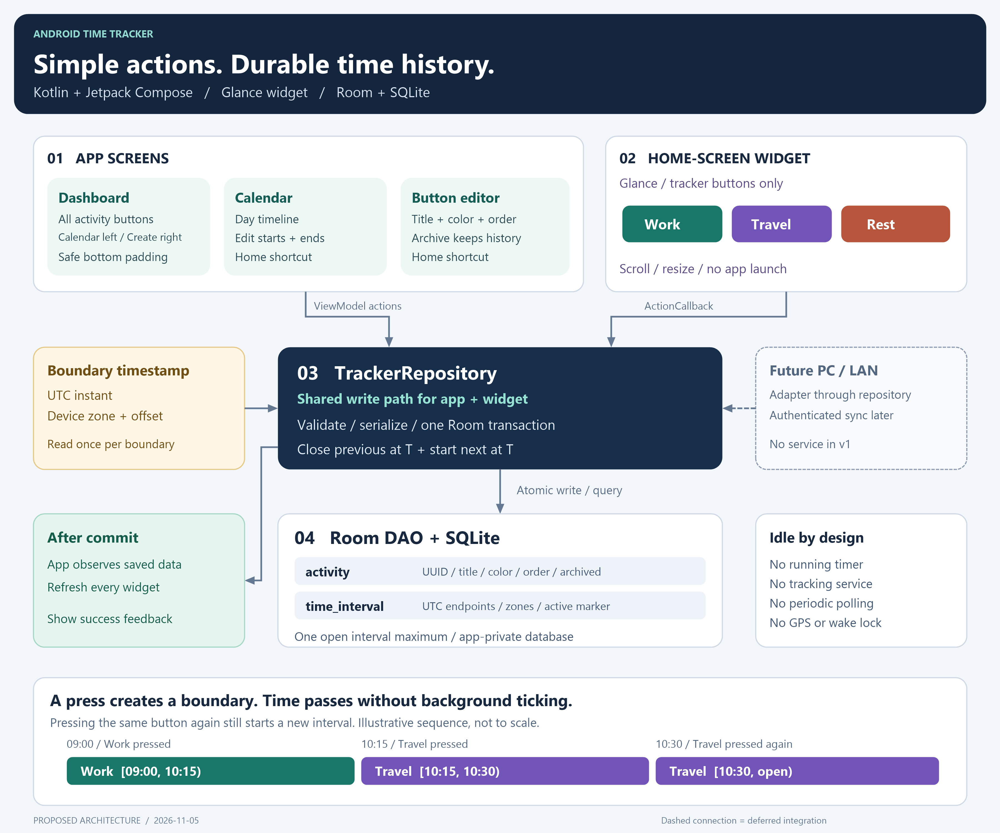

# Android Time Tracker — Architecture

Status: proposed architecture, ready for implementation. This document and its diagram describe the app; they are not an implemented or benchmarked application.

## 1. Main decision

Build a native Android app in **Kotlin**, using **Jetpack Compose** for its screens, **Room over SQLite** for storage, and **Jetpack Glance** for the Android home-screen widget.

The most important battery decision is the execution model: **record timestamps when the user acts, then let the app become idle**. An active tracker is a database row with no end timestamp. It does not require a running timer, service, alarm, or background loop.

Kotlin is the practical choice for this workload. Android's UI, database, lifecycle, and widget libraries integrate directly with it. Rust could help a future CPU-heavy component after measurement, but this app primarily performs small database transactions and renders UI. There is no evidence that a Rust core would reduce its battery consumption enough to justify native bindings and extra build complexity. Android recommends Kotlin for new Android apps. [Android Kotlin guidance](https://developer.android.com/kotlin/first)

The design aims for very low idle battery use. It cannot promise zero battery use: launches, database writes, widget callbacks, rendering, and Android-managed widget sessions still consume resources.

## 2. Architecture image

The editable vector version is [architecture.svg](architecture.svg).

Solid connections describe the initial app. The dashed PC/LAN connection is a future integration point, not an initial service.

## 3. User experience

### Dashboard / Home

- Show every non-archived activity as a large, titled, colored button in a scrollable layout.
- Put the **Calendar** shortcut at the top left and **Create Button** at the top right.
- Highlight the active activity with an outline/check as well as its color. Do not rely on color alone.
- On a successful press, show **"(button name) tracker is set"**, replacing the placeholder with the actual title. Show this only after the database commit succeeds.
- Pressing the same activity again closes its current interval and starts a separate interval for that same activity. It never toggles tracking off.
- When no activities exist, show a clear Create Button action.
- Keep the last button fully reachable above Android's navigation controls: consume the relevant system insets once, then add at least **16 dp** of extra scroll-content padding. Account for both gesture navigation and three-button navigation.

The original request places both shortcuts at the top left. This design interprets the second placement as top right so both remain immediately accessible.

Use a Compose `Scaffold` and apply its content padding correctly. Apply navigation/safe-drawing insets at one layer, rather than doubling them on nested containers. Include keyboard insets in the editor. [Android inset guidance](https://developer.android.com/develop/ui/compose/system/insets-ui)

### Calendar

- Start with a day timeline, date navigation, and a date picker. A week view can follow without changing storage.
- Show colored activity blocks with titles, start/end times, and durations. Include the current open interval.
- Select a block to edit its start and end, including the date and time zone of each endpoint.
- Provide a visible **Home** shortcut and normal Android Back behavior.
- Show the calendar's display time zone in the header. Default it to the device's current time zone.
- Clip intervals across visible day boundaries for rendering; do not split their stored rows at midnight.
- Query only the visible date range, rather than loading the entire history.

Calendar edit rules:

1. End must be at or after start. Historical records cannot extend into the future.
2. Intervals cannot overlap. Intentional gaps are allowed after manual corrections.
3. If an edited boundary is shared with an adjacent interval, offer **Move shared boundary** to change both endpoints in one transaction. Otherwise reject an overlap and explain how to correct it.
4. Saving an end for the currently open interval closes it and leaves tracking idle. Editing the open interval's start keeps it active.
5. Zero-duration intervals are valid when rapid presses share the same millisecond. Preserve their records, but omit them from duration totals and tiny calendar blocks.

### Create / edit activity button

- Provide a title field, color picker, preview, Save action, and visible **Home** shortcut.
- Require a non-empty trimmed title. Use a practical initial limit such as 60 characters.
- Choose readable foreground text for each background color. Support screen readers, font scaling, and at least 48 dp touch targets.
- Allow existing activities to be renamed, recolored, reordered, or archived from this screen.
- Archiving removes the activity from the dashboard and widget while preserving history. Require switching away from, or ending, an active activity before archiving it.
- In the initial version, historical blocks use the activity's current title and color. Renaming or recoloring therefore updates their presentation too.

### Android home-screen widget

The widget lives on the Android launcher's home screen. Its visible interactive content consists **only of the same titled, colored tracker buttons**. There are no calendar, Home, settings, or creation shortcuts inside it.

- Use a resizable, scrollable button collection so a small widget can still reach all activities. Validate scrolling on actual supported launchers.
- Each button invokes a Glance `ActionCallback` with an activity ID and calls the same repository operation used by the dashboard.
- A tap must work without opening the main activity. Keep the callback short and limit it to local work.
- After a successful commit, refresh every installed instance of this app's widget and highlight the active button.
- Request a standard text toast with the same success wording. Android/launcher behavior may limit background feedback, so the refreshed active-button appearance also confirms success. A failed save must never produce a success message.
- An empty widget can show a non-interactive message asking the user to create buttons in the app. It does not add a navigation control.
- If a stale widget references an archived activity, reject the action, refresh the widget, and explain the failure through available transient feedback.

Glance has its own supported UI components; app Compose screens cannot simply be embedded into a widget. Share activity data and behavior, then render each surface separately. Glance callbacks use Android-managed execution and have background restrictions. [Glance actions](https://developer.android.com/develop/ui/compose/glance/user-interaction)

## 4. Components and responsibilities

Use one Android application module initially, with ordinary package boundaries. Multiple Gradle modules, a dependency-injection framework, and a separate server are unnecessary for this scope.

| Component | Responsibility |
| --- | --- |
| Compose screens + ViewModels | Dashboard, calendar, activity editor, visible UI state, and transient messages. |
| Glance widget + ActionCallback | Render tracker buttons and handle short widget actions. |
| `TrackerRepository` | Shared mutation entry point, validation, serialized writes, switching, calendar corrections, and activity changes. Use a concrete class initially. |
| `java.time` + injectable `Clock` | Capture an instant and obtain the current device zone for each boundary. Allow deterministic time tests. |
| Room database + DAOs | SQL queries, transactions, schema migrations, foreign keys, and observable query results. |
| SQLite file | Durable, app-private source of truth for activities and intervals. |
| Future sync adapter | Later calls repository operations; never writes around validation or owns a second active tracker. |

Room is a SQLite access layer, not a different database. It provides query checking and migration support. Keep database operations asynchronous and off the main thread. [Room overview](https://developer.android.com/training/data-storage/room)

Keep application-owned components in the default app process. Do not assign the widget receiver a separate process. Share one Room instance and one repository write gate within that process. SQLite constraints and transactions remain the final storage safeguards.

## 5. What happens on a button press

All accepted app and widget actions follow this path:

1. Enter the shared write gate. Start one Room database transaction.
2. Verify that the selected activity still exists and is not archived.
3. Capture **one boundary**: UTC instant `T`, current device zone ID, and that zone's UTC offset at `T`.
4. Read the open interval, if one exists. Validate `T` against its start and the existing timeline.
5. Close the open interval using exactly `T` and that boundary's zone/offset; clear its active marker.
6. Insert a new interval for the pressed activity, starting at exactly `T`, with no end and the active marker set.
7. Commit. On any error, roll back both changes.
8. Notify the caller of success, let visible screens observe the committed data, and request updates for all widget instances.

Room's transaction API is the boundary for the close-and-create operation. Never perform those writes in separate transactions. [Room transaction API](https://developer.android.com/reference/androidx/room/RoomDatabaseKt)

Example:

| Press | Stored result |
| --- | --- |
| Work at 09:00 | Work `[09:00, open)` |
| Travel at 10:15 | Work `[09:00, 10:15)`, Travel `[10:15, open)` |
| Travel again at 10:30 | Travel `[10:15, 10:30)`, new Travel `[10:30, open)` |

Intervals use **inclusive starts and exclusive ends**: `[start, end)`. A shared endpoint belongs to the following interval, avoiding double counting.

Serialize concurrent actions from the dashboard and multiple widget instances. Each accepted press creates a boundary, including repeated presses on the same activity. Do not merge or debounce those presses as a shortcut. A callback that Android never delivers cannot be recorded; confirmation means the database commit completed, not that a tap animation occurred.

If the app dies before commit, SQLite rolls back the switch. If it dies after commit but before a widget refresh, tracking is already saved; the next widget/app refresh reloads SQLite. Widget appearance can temporarily lag the committed state. Do not rely on widget-rendered state as tracking state.

## 6. Time zones, travel, and clock changes

### Storage

Store each endpoint as:

- An absolute UTC instant, represented as epoch milliseconds in SQLite.
- An IANA zone ID such as `Europe/Zurich` or `Asia/Tokyo`.
- The actual UTC offset in seconds at that instant.

Start and end metadata are independent because travel or daylight-saving changes can occur between them. Store the captured offset so the originally recorded local label remains reproducible even if zone rules later change.

Read `ZoneId.systemDefault()` for each new boundary; do not cache it for the application's lifetime. This follows the phone's configured time zone. It does **not** establish physical location: if automatic time-zone detection is disabled or wrong, the app cannot infer the user's true zone without another input. Use Android's automatic date/time and zone settings; no GPS or location permission is needed. [ZoneId behavior](https://docs.oracle.com/en/java/javase/22/docs/api/java.base/java/time/ZoneId.html)

### Display and duration

- Compute elapsed duration using UTC instants, never by subtracting local clock labels.
- Render the timeline in one explicit display zone. Default to the device's current zone; changing that zone may move historical blocks on screen without changing their stored instants.
- Show each endpoint's recorded local time, zone, and offset in interval details so travel remains understandable.
- For daily totals, intersect intervals with the selected display zone's day boundaries. Obtain the next day with calendar/date operations; never assume every day lasts 24 hours.
- An open interval's displayed duration is calculated from its start and the current instant when the screen renders. A minute-level refresh is enough while that screen is visible; suspend it when hidden. The widget does not show a ticking duration.

For example, starting at 10:00 in Zurich at UTC+1 and ending at 20:00 in Tokyo at UTC+9 gives **2 hours**, not 10 hours.

### Editing ambiguous local times

During daylight-saving transitions, a local time may not exist or may occur twice. Reject nonexistent times with an explanation. For a repeated time, ask which offset the user means, displaying both choices. Do not silently accept `ZonedDateTime`'s default gap adjustment or overlap choice. [ZonedDateTime rules](https://docs.oracle.com/en/java/javase/19/docs/api/java.base/java/time/ZonedDateTime.html)

### Device clock corrections

UTC wall-clock time can also be manually changed or corrected by the system. A time-zone change alone does not cause this problem.

If a new boundary would precede the active start or overlap saved history, reject the switch, preserve existing data, and ask the user to correct the clock or calendar entry. Do not silently clamp the timestamp. Other clock adjustments, particularly across a reboot, cannot be reconstructed perfectly from two wall-clock timestamps alone; calendar correction remains the initial recovery method.

Android's `elapsedRealtime()` is useful for monotonic measurements within one boot, but cannot replace calendar timestamps across reboots. It is optional diagnostic data later, not a background service requirement. [Android clock APIs](https://developer.android.com/reference/android/os/SystemClock)

## 7. SQLite data model

Use two tables. UUID text IDs provide stable identities for future export/sync without building synchronization now. All `created_at_ms` and `updated_at_ms` values are UTC epoch milliseconds.

### `activity`

| Field | Type / purpose |
| --- | --- |
| `id` | TEXT primary key, UUID. |
| `title` | TEXT, non-empty user-visible title. |
| `color_argb` | INTEGER, stored Android color. |
| `sort_order` | INTEGER, dashboard/widget ordering. |
| `is_archived` | INTEGER boolean, default false. |
| `created_at_ms`, `updated_at_ms` | INTEGER, creation/change timestamps. |

### `time_interval`

| Field | Type / purpose |
| --- | --- |
| `id` | TEXT primary key, UUID. |
| `activity_id` | TEXT foreign key to `activity.id`; reject destructive deletion while referenced. |
| `start_at_ms` | INTEGER, absolute start instant. |
| `start_zone_id`, `start_offset_seconds` | TEXT + INTEGER, captured start context. |
| `end_at_ms` | Nullable INTEGER; NULL means open. |
| `end_zone_id`, `end_offset_seconds` | Nullable TEXT + INTEGER; both NULL exactly when end is NULL. |
| `active_slot` | Nullable INTEGER; exactly `1` for an open interval, NULL for a closed interval. |
| `created_at_ms`, `updated_at_ms` | INTEGER, creation/change timestamps. |

Add a **unique index on `active_slot`**. SQLite permits multiple NULLs in a unique index but only one value of `1`, enforcing at most one open interval. Validate that the only non-NULL marker is `1` and that marker/end nullability agree. Add SQL CHECK constraints in schema creation/migrations where needed; test the actual Room-generated/migrated schema rather than assuming entity annotations express every invariant. [SQLite uniqueness and NULL handling](https://www.sqlite.org/lang_createindex.html)

Additional indexes: `time_interval(start_at_ms)`, `time_interval(activity_id, start_at_ms)`, and the foreign-key index if it is not already covered by that composite index. Keep duration and active activity derived from intervals; do not add duplicate mutable state or write a row every minute.

For a visible window `[from, to)`, query intervals where `start_at_ms < to` and `(end_at_ms IS NULL OR end_at_ms > from)`. Perform overlap validation inside the same serialized transaction as any edit. Exclude zero-duration intervals from overlap checks. For two positive-duration intervals, overlap exists when each starts before the other's end; an open end acts as infinity.

Use app-private storage with no broad storage permission. Keep a versioned Room schema and explicit migrations. Never use destructive migration as a release fallback. Decide and document Android backup behavior before release; app-private storage alone does not mean encrypted or backed up. A manual export/import can be added as a separate, user-initiated feature.

## 8. Battery and performance budget

| Situation | Intended work |
| --- | --- |
| Tracker active, app hidden | No application timer loop and no app-scheduled periodic tracking work. The open SQLite interval is sufficient. |
| Activity button press | One short local transaction, transient feedback, and event-driven widget refresh. |
| Calendar visible | Read the visible range, render blocks, optionally refresh open-duration labels once a minute. |
| Activity title/color/order changes | One transaction and refresh of visible app/widget data. |
| Device restart / process recreation | Load persisted state when the app/widget is next used. No boot service is required to keep an interval open. |

Set widget `updatePeriodMillis="0"` to disable periodic provider updates. Refresh on placement, resizing, launcher/system update requests, successful tracking actions, and activity edits. Glance may use short Android-managed sessions/work internally; disabling periodic updates does not eliminate that framework activity. [Widget update guidance](https://developer.android.com/develop/ui/views/appwidgets/advanced)

The initial app needs no foreground service, ongoing notification, wake lock, exact alarm, GPS polling, network polling, or scheduled sync worker. Do not request battery-optimization exemptions. There is no app-owned recurring WorkManager job for tracking. Add persistent background work only when a concrete future feature requires it.

Initial platform assumption: **Android 8.0 / API 26 or later**, which provides `java.time` directly. Revisit this only if older-device support is required. Choose compatible stable AndroidX versions during implementation.

Measure performance on a release build and a physical device. Check warm/cold widget action latency and idle background activity separately. Use wakeup/job inspection and a controlled idle comparison before making battery claims; do not infer them from the programming language alone.

## 9. Future PC / LAN support

Keep local SQLite authoritative for the initial app. Stable UUIDs, explicit timestamps, zone metadata, and a shared validated write path make later integration possible without running a server now.

When PC/LAN work becomes a real requirement, add an adapter for user-triggered export, authenticated LAN transfer, or synchronization. Reuse repository validation. Decide pairing, authentication, encryption, conflict resolution, deletion/tombstone handling, and ownership of the single active tracker at that stage. `updated_at_ms` alone is not a safe conflict-resolution algorithm because device clocks can disagree.

If automatic synchronization is later required, add a transactional change log/outbox and Android-appropriate constrained background work then. Historical rows can be merged by stable IDs under an explicit policy; independently running live trackers on multiple devices need an explicit conflict policy. Do not silently combine them.

## 10. Implementation order and acceptance checks

1. **Persistence and switching:** build the two tables, repository, transaction, and time capture. Verify first press, different activity, same activity again, identical-millisecond presses, rapid concurrent app/widget actions, failure rollback, and process recreation. Assert at most one open interval and exact equality of the old end/new start.
2. **Dashboard and activity editor:** verify title/color persistence, active indication, success wording after commit, archive behavior, Home/Back navigation, empty state, large text, and accessible contrast. Verify the final button clears both Android navigation modes.
3. **Calendar:** verify visible-range queries, editable endpoints, shared-boundary corrections, overlap rejection, midnight clipping, 23/25-hour days, DST gap/overlap editing, travel, and clock rollback handling.
4. **Widget:** verify buttons-only interaction without launching the app, all-button reachability, multiple widget instances, resizes, stale activity IDs, process death, and reconstruction after restart. Test at least the launchers/devices intended for support, including normal Android stopped-app limitations.
5. **Release validation:** test Room migrations with existing data, inspect permissions and backup policy, and measure action latency plus idle background work on real hardware.

These are implementation acceptance criteria, not tests already run. Deliver the core tracker and widget before starting PC/LAN features.

## References

Official documentation checked on 2026-11-05. Product-specific behavior in this document is a design decision; linked platform behavior comes from the references alongside it. No measured Kotlin-versus-Rust performance claim is being made.
